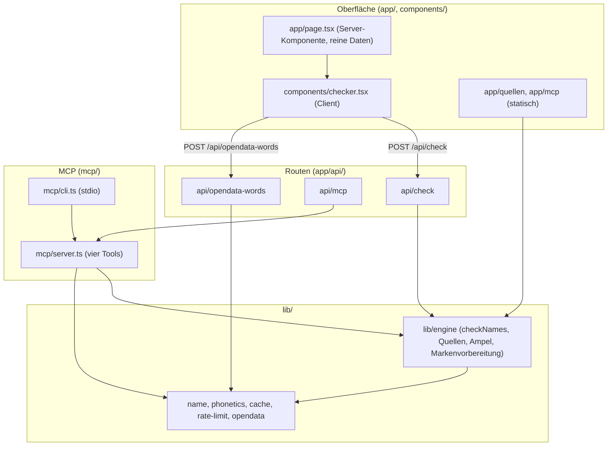

# `src/`: Aufbau und Datenfluss

Der Quellcode von Markenfrei: Oberfläche und Routen (Next.js 16 App Router), die Engine in
`lib/engine/` und der MCP-Server in `mcp/`. Oberfläche, HTTP-API und MCP nutzen dieselbe
Engine.

---

## Übersicht



---

## Verzeichnisse

| Pfad | Inhalt |
|---|---|
| `app/page.tsx` | Startseite. Die Server-Komponente gibt der Client-Komponente nur reine Daten (Quellen-IDs, Labels, Beschreibungen, Endungen, Grenzwerte), keinen Engine-Code. |
| `app/quellen/page.tsx` | Statische Seite mit allen Endungen und Quellen samt Endpunkt und Markenlinks. |
| `app/mcp/page.tsx` | Statische Seite zur Einrichtung des MCP-Servers (Claude Code, Claude Desktop, Cursor). |
| `app/layout.tsx`, `app/globals.css` | Rahmen (`lang="de"`, Sprunglink, Kopf- und Fußzeile, Schriften, Skript für die gewählte Darstellung vor dem ersten Zeichnen) und das Gestaltungssystem: Farbvariablen für hell und dunkel über `prefers-color-scheme` oder die Wahl im Seitenkopf (`data-theme`, Kontrastwerte im Kommentar), gemeinsame Klassen (`.btn`, `.chip`, `.card`, `.stamp`, `.lamp`, `.eyebrow`), Bewegung und Druckansicht. |
| `app/api/` | Routen, siehe [app/api/README.md](app/api/README.md). |
| `components/` | `checker.tsx` (hält die Eingaben und die Ansicht, verbindet die Teile unten), `check-form.tsx` (Formular, Eingabe-Vorschau, Vorhaben und Auswahl), `use-check-run.ts` (Prüflauf: höchstens 3 Anfragen gleichzeitig, automatische Wiederholung bei Lücken, Abbruch, übrige Endungen nachprüfen), `check-run.ts` (Lauf-Typen, `deriveRun`, `cancelRun`, `mergeResults` und JSON-Export als reine Funktionen, getestet in `tests/check-run.test.ts`), `check-results.tsx` (Ergebnisbereich mit Laufanzeige, Filter, Exporten und „Stand kopieren“), `changes-notice.tsx` (Änderungen seit der letzten Prüfung), `snapshot-view.tsx` (Ansicht „Stand vom …“ aus dem Link), `use-print-expand.ts` (Berichtszeilen vor dem Druck aufklappen), `checker-config.ts` (Auswahl, Link-Zustand, `previewNames`), `verdict-text.ts` (Texte der Ergebnisliste), `report-card.tsx` (Berichtskarte mit Belegen, Ausweichnamen und dem Registrierungs-Link des Betreibers), `verdict-panel.tsx`, `match-list.tsx`, `matrix-view.tsx`, `status-badge.tsx`, `trademark-block.tsx` (Markenblock mit Produktbeschreibung und Klassenwahl), `name-insights.tsx`, `idea-finder.tsx`, `variant-picker.tsx`, `recent-checks.tsx` (Verlauf „Zuletzt geprüft“, nur im Browser und nur wenn eingeschaltet), `theme-toggle.tsx` (Darstellung: System, Hell, Dunkel), `menu.tsx` (Aufklappmenü für Exporte und Darstellung), `chip.tsx`, `chevron.tsx`, `copy-button.tsx`, `code-block.tsx`, `download.ts`, `guide.tsx` (Rahmen der Anleitungsseiten), `page-toc.tsx` (Inhaltsverzeichnis langer Seiten), `contact-form.tsx`, `operator-notice.tsx` (Betreiberangaben zur Laufzeit), `pageview-beacon.tsx` (Reichweitenmessung), `signal-mark.tsx`, `site-nav.tsx`, `site-header.tsx`, `site-footer.tsx`. |
| `lib/` | Engine und Hilfsmodule, siehe [lib/README.md](lib/README.md). |
| `mcp/` | `server.ts` mit `createMarkenfreiMcpServer` und den Tools `markenfrei_check_name`, `markenfrei_check_names` (beide mit `profile`), `markenfrei_trademark_prep`, `markenfrei_suggest_names` sowie den Server-Anweisungen für Coding-Agenten; `cli.ts` startet ihn über stdio. Das veröffentlichbare Paket baut `mcp/build.mjs` im Repo-Wurzelordner. |
| `cli/` | Kommandozeile `npm run cli -- check <name…>` auf derselben Engine: `main.ts` (Einstieg), `run.ts` (Argumente, Ausgabe, Exit-Code nach der Ampel). |

Der Pfad-Alias `@/*` zeigt auf `src/*` (`tsconfig.json`).

---

## Invarianten

1. **Kein LLM, keine Schlüssel.** Alle Quellen sind offen; `GITHUB_TOKEN` ist optional.
2. **Keine Speicherung von Anfragen auf dem Server.** Der Server hält nur einen kurzen Cache
   eindeutiger Quellenantworten im Arbeitsspeicher (Standard 10 Minuten). Der Browser hält den
   Zustand im Link (`?q=…&tld=…&ns=…&src=…`) und speichert sonst nur, was jemand selbst einschaltet:
   die gewählte Darstellung (`lib/theme.ts`) und den Verlauf „Zuletzt geprüft“ (`lib/history.ts`).
   Beides bleibt im Browser und erreicht den Server nie.
3. **`unknown` ist nie frei.** Timeout, Rate-Limit, Fehler oder unerwartetes Format ergeben
   `unknown`; schon eine solche Quelle verhindert Grün.
4. **Marke ist immer „nicht geprüft“.** Statt einer Ampel gibt es die Recherche-Vorbereitung.
5. **Zeitgrenzen.** 5 s pro Anfrage, 8 s pro Prüfung, höchstens 4 gleichzeitige Anfragen pro
   Host.

---

## Befehle

```bash
npm run dev        # Entwicklungsserver
npm test           # Offline-Tests
npm run lint       # ESLint
npm run build      # Produktions-Build
npm run mcp        # MCP-Server über stdio aus den Quellen
npm run build:mcp  # MCP-Bündel nach mcp/dist/
```
