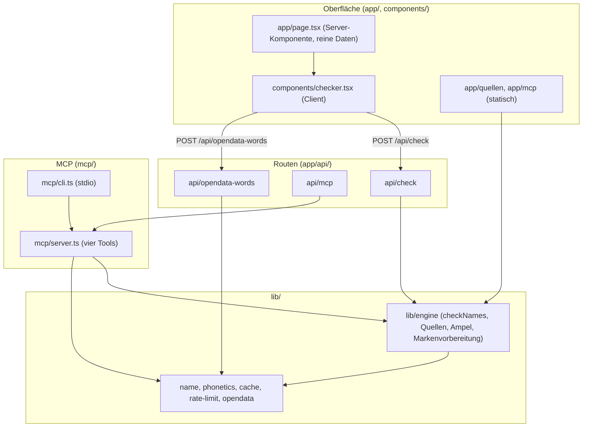

# `src/`: Aufbau und Datenfluss

Der Quellcode von Markenfrei: Oberfläche und Routen (Next.js 16 App Router), die Engine in
`lib/engine/` und der MCP-Server in `mcp/`. Oberfläche, HTTP-API und MCP nutzen dieselbe
Engine.

---

## Übersicht



---

## Verzeichnisse

| Pfad | Inhalt |
|---|---|
| `app/page.tsx` | Startseite. Die Server-Komponente gibt der Client-Komponente nur reine Daten (Quellen-IDs, Labels, Beschreibungen, Endungen, Grenzwerte), keinen Engine-Code. |
| `app/quellen/page.tsx` | Statische Seite mit allen Endungen und Quellen samt Endpunkt und Markenlinks. |
| `app/mcp/page.tsx` | Statische Seite zur Einrichtung des MCP-Servers (Claude Code, Claude Desktop, Cursor). |
| `app/layout.tsx`, `app/globals.css` | Rahmen (`lang="de"`, Sprunglink, Kopf- und Fußzeile) und Farbvariablen für hell und dunkel über `prefers-color-scheme`. |
| `app/api/` | Routen, siehe [app/api/README.md](app/api/README.md). |
| `components/` | `checker.tsx` (hält die Eingaben und die Ansicht, verbindet die Teile unten), `check-form.tsx` (Formular und Auswahl), `use-check-run.ts` (Prüflauf: höchstens 3 Anfragen gleichzeitig, automatische Wiederholung bei Lücken, Abbruch), `check-run.ts` (Lauf-Typen, `deriveRun` und JSON-Export als reine Funktionen, getestet in `tests/check-run.test.ts`), `check-results.tsx` (Ergebnisbereich), `use-print-expand.ts` (Berichtszeilen vor dem Druck aufklappen), `chip.tsx`, `download.ts`, `checker-config.ts` (Auswahl und Link-Zustand), `report-card.tsx`, `status-badge.tsx`, `trademark-block.tsx`, `shortlist-ranking.tsx`, `idea-finder.tsx`, `copy-button.tsx`, `site-header.tsx`, `site-footer.tsx`. |
| `lib/` | Engine und Hilfsmodule, siehe [lib/README.md](lib/README.md). |
| `mcp/` | `server.ts` mit `createMarkenfreiMcpServer` und den Tools `markenfrei_check_name`, `markenfrei_check_names`, `markenfrei_trademark_prep`, `markenfrei_suggest_names`; `cli.ts` startet ihn über stdio. Das veröffentlichbare Paket baut `mcp/build.mjs` im Repo-Wurzelordner. |

Der Pfad-Alias `@/*` zeigt auf `src/*` (`tsconfig.json`).

---

## Invarianten

1. **Kein LLM, keine Schlüssel.** Alle Quellen sind offen; `GITHUB_TOKEN` ist optional.
2. **Keine Speicherung von Anfragen.** Der Server hält nur einen kurzen Cache eindeutiger
   Quellenantworten im Arbeitsspeicher (Standard 10 Minuten). Der Browser hält den Zustand
   nur im Link (`?q=…&tld=…&ns=…&src=…`).
3. **`unknown` ist nie frei.** Timeout, Rate-Limit, Fehler oder unerwartetes Format ergeben
   `unknown`; schon eine solche Quelle verhindert Grün.
4. **Marke ist immer „nicht geprüft“.** Statt einer Ampel gibt es die Recherche-Vorbereitung.
5. **Zeitgrenzen.** 5 s pro Anfrage, 8 s pro Prüfung, höchstens 4 gleichzeitige Anfragen pro
   Host.

---

## Befehle

```bash
npm run dev        # Entwicklungsserver
npm test           # Offline-Tests
npm run lint       # ESLint
npm run build      # Produktions-Build
npm run mcp        # MCP-Server über stdio aus den Quellen
npm run build:mcp  # MCP-Bündel nach mcp/dist/
```
