# `src/` · MarkenFrei Anwendungs- und Architekturschicht

Dieses Verzeichnis bildet die Wurzel des TypeScript-Quellcodes der **MarkenFrei**-Anwendung. Es vereint die Benutzeroberfläche und das Routing (Next.js 16 App Router), die serverseitigen API-Schnittstellen für Clearance-Checks und KI-Generierung sowie den domain- und algorithmenspezifischen Kern.

---

## 1. Architektur & Komponenten-Übersicht

```mermaid
flowchart TD
    subgraph UI ["Präsentationsschicht (src/app & src/components)"]
        Page["page.tsx (Home - Minimalist UI)"]
        Layout["layout.tsx (RootLayout)"]
        Theme["globals.css (Tailwind v4 Theme)"]
        ResultRow["components/result-row.tsx"]
        DetailPanel["components/detail-panel.tsx"]
        SettingsDialog["components/settings-dialog.tsx"]
    end

    subgraph API ["Gateway & Route Handler (src/app/api)"]
        ClearanceRoute["api/clearance/route.ts"]
        ReaRoute["api/rea-inspect/route.ts (REA Bridge)"]
        GenerateRoute["api/generate/route.ts"]
        OpenDataRoute["api/opendata-words/route.ts"]
        OllamaRoute["api/ollama-models/route.ts"]
    end

    subgraph LIB ["Domain & Algorithmen (src/lib)"]
        OpenDataLib["opendata.ts (Lexik & Synthese)"]
        PhoneticsLib["phonetics.ts (Phonetik & Markenrecht)"]
        ScoringLib["scoring.ts (Brandability & Matrix)"]
        ReaLib["rea.ts (Bundle-IDs & Plist Inspector)"]
        DohLib["doh.ts (DNS-over-HTTPS Fallback)"]
        ProvidersLib["providers.ts (Multi-Provider Registry)"]
        VerdictLib["verdict.ts (Signal- & Ampel-Logik)"]
    end

    subgraph EXT ["Externe Register & Schnittstellen"]
        OpenThesaurus["OpenThesaurus.de API"]
        Datamuse["Datamuse / WordNet API"]
        RDAP["Autoritative RDAP-Server (DENIC, Verisign, Google, Identity Digital)"]
        DoH_DNS["Google & Cloudflare DNS-over-HTTPS"]
        AppStore["Apple iTunes & Google Play Store"]
        Wikidata["Wikidata Entity Search API"]
        GitHub_npm["GitHub, npm, PyPI, Crates.io, Homebrew"]
        LLM_APIs["Google Gemini / Anthropic / OpenAI / Ollama"]
    end

    Page -->|POST /api/clearance| ClearanceRoute
    Page -->|POST /api/rea-inspect| ReaRoute
    Page -->|POST /api/generate| GenerateRoute
    Page -->|POST /api/opendata-words| OpenDataRoute
    Page -->|GET /api/ollama-models| OllamaRoute

    ClearanceRoute --> PhoneticsLib
    ClearanceRoute --> ScoringLib
    ClearanceRoute --> ReaLib
    ClearanceRoute --> DohLib
    ClearanceRoute --> RDAP
    ClearanceRoute --> DoH_DNS
    ClearanceRoute --> AppStore
    ClearanceRoute --> Wikidata
    ClearanceRoute --> GitHub_npm

    ReaRoute --> ReaLib
    ReaRoute --> PhoneticsLib
    ReaRoute --> AppStore

    GenerateRoute --> OpenDataLib
    GenerateRoute --> ProvidersLib
    GenerateRoute --> LLM_APIs

    OpenDataRoute --> OpenDataLib
    OpenDataLib --> OpenThesaurus
    OpenDataLib --> Datamuse
```



---

## 2. Verzeichnis-Hierarchie & Verantwortlichkeiten

| Pfad | Typ | Verantwortung |
|---|---|---|
| [`app/`](file:///Users/michaelkatschko/Projects/MarkenFrei/src/app) | UI & Routing | Next.js App Router Root mit Layouts, Pages, Modals und Tailwind-Design-Tokens. |
| [`app/api/`](file:///Users/michaelkatschko/Projects/MarkenFrei/src/app/api) | API-Gateway | Server-Side Route Handlers für parallele Multi-Source-Prüfungen und LLM-Aufrufe. |
| [`components/`](file:///Users/michaelkatschko/Projects/MarkenFrei/src/components) | UI-Komponenten | Reduzierte Komponenten: `ResultRow`, `DetailPanel`, `SettingsDialog`. |
| [`lib/`](file:///Users/michaelkatschko/Projects/MarkenFrei/src/lib) | Domain Core | Zustandslose Algorithmen: Kölner Phonetik, Nizza-Klassen, Open-Data-Morpheme, Scoring, Verdicts. |

---

## 3. Öffentliche Schnittstellen & Typ-Exports

Die Schichten kommunizieren über streng typisierte TypeScript-Verträge:

- **Path Alias:** `@/*` ist in `tsconfig.json` als `./src/*` gemappt.
- **Zustandsspeicherung:** Lokale Persistenz von Provider-Konfigurationen und API-Schlüsseln erfolgt im Browser via `localStorage` unter dem Schlüssel `markenfrei.llm.v1`.
- **Farb- & Token-System (`app/globals.css`):**
  - `--color-canvas: #fbfbfa` / `--color-surface: #ffffff`
  - `--color-ink: #111111` / `--color-muted: #787774`
  - `--color-ok: #346538` / `--color-warn: #956400` / `--color-bad: #9f2f2d`

---

## 4. Invarianten & Sicherheits-Garantien

1. **Zero-Key-Autonomie:** Die Anwendung ist ohne jegliche Konfiguration oder API-Schlüssel voll funktionsfähig (Fallback auf Open-Data Wortfeld- und Morphem-Synthese).
2. **Datenschutz (Privacy by Default):** Eingegebene API-Schlüssel für Fremdanbieter verbleiben im Browser des Nutzers und werden ausschließlich serverseitig als flüchtige Request-Header zur API-Autorisierung durchgereicht.
3. **Resilienz & Timeouts:** Jeder externe HTTP-Aufruf ist durch `AbortSignal.timeout` (1500ms bis 5000ms) geschützt, um Thread-Blocking im Server-Runtime zu verhindern.
4. **Fehlertoleranz bei Verfügbarkeit:** Wenn eine externe Quelle nicht antwortet (z.B. Rate-Limit oder Timeout), wird der Status auf `unknown` gesetzt – niemals fälschlich auf `available`.

---

## 5. Build- & Testkommandos

```bash
# Entwicklungsserver mit Turbopack starten
npm run dev

# TypeScript-Kompilierung & Produktions-Build
npm run build

# Linter ausführen
npm run lint
```
