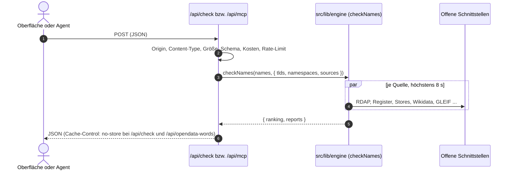

# `src/app/api/`: HTTP-Routen

Sechs Route Handler: vier mit `POST` (Prüfung, MCP, Wortfeld, Kontakt) und zwei mit `GET`
(`/api/openapi.json`, `/api/health`). Keine LLM-Aufrufe, keine Speicherung von Anfragen.
Gemeinsame Bausteine liegen in `_lib/http.ts` (der Ordner beginnt mit `_` und ist keine Route):
Body-Grenze, Content-Type, Origin-Prüfung, Kosten und Rate-Limit.

Jede Route geht durch `guardRequest` aus `src/lib/rate-limit.ts` (Standard 60 Einheiten pro
Minute und Client). Anfragen mit ausgehenden Abfragen zählen zusätzlich gegen ein Limit pro
Prozess (`MARKENFREI_GLOBAL_RATE_LIMIT`, Standard 600 Einheiten pro Minute). Es greift auch,
wenn jemand das Limit pro Client umgeht, und schützt die Server-IP vor Sperren bei den
abgefragten Diensten. Bei Überschreitung kommt `429` mit `Retry-After`.

**Kosten einer Prüfung:** verschiedene Namen (nach Normalisierung) × `ceil(aufgelöste Quellen /
Quellen der Standardauswahl)`. Die Standardauswahl kostet 1 je Name, alle Quellen mit 8 Endungen
kosten ein Vielfaches.

**Origin:** Eigene Origins kommen nur aus der Konfiguration, nie aus `Host` oder
`X-Forwarded-Host` (die setzt der Client, bei DNS-Rebinding passen sie immer zum Origin):
`MARKENFREI_PUBLIC_URL` (Standard `https://markenfrei.app`), `MARKENFREI_ALLOWED_ORIGINS`
sowie `localhost`, `127.0.0.1` und `[::1]` mit beliebigem Port. Ein fehlender Origin ist erlaubt
(Kommandozeile, Server).

| Route | Zweck | Kosten fürs Rate-Limit |
|---|---|---|
| `POST /api/check` | Prüfung eines Namens oder einer Shortlist für die Oberfläche | Namen × Quellenumfang |
| `POST /api/mcp` | MCP über Streamable HTTP, derselbe Server wie bei stdio | Namen × Quellenumfang bei `markenfrei_check_name` und `markenfrei_check_names`, sonst 1 |
| `POST /api/opendata-words` | Wortfeld und regelbasierte Vorschläge für „Keine Idee?“ | 1 |
| `POST /api/contact` | Kontaktformular: sendet eine Nachricht per E-Mail an den Betreiber | 1 (allgemeines Limit) plus eigenes Limit nur für gesendete Nachrichten |
| `GET /api/openapi.json` | OpenAPI-3.1-Beschreibung der öffentlichen Routen | keine (kein Rate-Limit, keine Abfragen) |
| `GET /api/sources` | Katalog der Quellen, Namensräume und Endungen als JSON | keine (kein Rate-Limit, keine Abfragen) |
| `GET /api/health` | Lebenszeichen für Monitoring | keine |



---

## `POST /api/check` (`check/route.ts`)

Eingabe (mit zod geprüft):

```json
{
  "names": ["wachwerk", "fokusnova"],
  "tlds": ["de", "com"],
  "namespaces": ["domains", "packages"],
  "sources": ["npm", "nuget"]
}
```

- `names`: 1 bis 10 Texte, Pflicht.
- `tlds`, `namespaces`, `sources`: optional. Ohne Angabe gelten die Standardwerte der Engine
  (Endungen `de`, `com`, `dev`, `app`, `io`; Namensräume `domains`, `packages`, `stores`,
  `known_names`).
- `sources` ersetzt die Standardauswahl außerhalb von Domains. Wer Zusatzquellen will, schickt
  die gewünschten Standardquellen mit (so macht es die Oberfläche).

Nur mit `Content-Type: application/json` (fremde Seiten lösen damit immer einen Preflight aus,
den die Route nicht beantwortet). Ein Origin muss konfiguriert sein (siehe oben) oder der Browser
meldet `Sec-Fetch-Site: same-origin`; so funktioniert die Oberfläche auch unter einer Domain, die
nicht eingetragen ist.

Ausgabe: `{ "ranking": ShortlistEntry[], "reports": NameReport[] }` aus `checkNames`.
`NameReport` hat `schemaVersion: 2`, `verdict`, `results` (ein `SourceResult` je Quelle),
`incomplete`, `trademark` und `manualLinks`. Die Antwort trägt `Cache-Control: no-store`.

Fehler, jeweils `{ "error": "<deutsche Meldung>" }`:

| Status | Fall |
|---|---|
| 400 | kaputtes JSON, falsche Typen, keine oder mehr als 10 Namen, unbekannte Endung, Quelle oder Namensraum, ungültiger Name |
| 403 | fremder Origin |
| 413 | Body größer als 16 KB (auch ohne `Content-Length`, der Body wird beim Lesen gezählt) |
| 415 | Content-Type ist nicht `application/json` |
| 429 | Rate-Limit erreicht |
| 500 | unerwarteter Fehler, allgemeine Meldung |

---

## `POST /api/mcp` (`mcp/route.ts`)

Zustandsloser MCP-Endpunkt (`WebStandardStreamableHTTPServerTransport`, Antworten als JSON).
Der Server kommt aus `src/mcp/server.ts`, damit stdio und HTTP dieselben vier Tools haben.

Prüfungen in dieser Reihenfolge:

1. **Origin:** fehlt der Header, ist der Aufruf erlaubt. Sonst nur die konfigurierten Origins
   und localhost (siehe oben), `Sec-Fetch-Site` zählt hier nicht. Andernfalls `403` mit
   JSON-RPC-Fehler `-32000`.
2. **Größe:** Body höchstens 64 KB, sonst `413` mit `-32600`.
3. **Rate-Limit:** Kosten wie in der Tabelle oben.
4. **Batch:** ein JSON-Array wird mit `400` und `-32600` abgelehnt.
5. Kaputtes JSON beantwortet der Transport mit `-32700`.

`GET` liefert `405`.

---

## `POST /api/opendata-words` (`opendata-words/route.ts`)

Eingabe (mit zod geprüft, Body höchstens 8 KB, nur `application/json`, Origin wie bei
`/api/check`): `{ "keywords": ["schicht", "plan"] }` (Liste oder kommagetrennter Text, 1 bis 6
Stichwörter mit 2 bis 40 Zeichen; kürzere fallen weg), optional `description` (bis 500 Zeichen),
`brandSeed` (bis 40), `maxLen` (ganze Zahl 4 bis 16, Standard 11) und `avoid` (bis 50 × 40).
Fehler kommen als `{ "error": "<deutsche Meldung>" }` mit 400, 403, 413, 415, 429 oder 500, nie
mit internen Meldungen. Alle Antworten tragen `Cache-Control: no-store`. Ausgabe ist das
`OpenDataWordField` aus `src/lib/opendata.ts`, darin `synthesizedCandidates`. Die Vorschläge
sind regelbasiert und ungeprüft; die Oberfläche prüft sie erst auf Klick über `/api/check`.

---

## `POST /api/contact` (`contact/route.ts`, Logik in `_lib/contact.ts`)

Eingabe (mit zod geprüft, Body höchstens 8 KB, nur `application/json`, Origin wie bei
`/api/check`): `{ "name"?: string (bis 100), "email": string (gültig, bis 200), "message": string
(10 bis 2000 Zeichen), "consent": true, "website": "", "t": string }`. Steuerzeichen (insbesondere
CR und LF) in Name und E-Mail werden abgelehnt (Header-Injection). Antworten enthalten nie
Eingaben des Besuchers; Name, Adresse und Text werden weder gespeichert noch protokolliert.

- `website` ist die Honigfalle: Ist sie befüllt, antwortet die Route `200 { "ok": true }` und sendet
  nichts.
- `t` ist die vom Server beim Rendern von `/kontakt` ausgestellte, mit HMAC-SHA-256 signierte
  Zeitmarke (`src/lib/contact-token.ts`). Frühestens 3 Sekunden und höchstens 2 Stunden nach dem
  Rendern, sonst `400`. Grenzen: Das Geheimnis ist pro Prozess zufällig (nach einem Neustart oder
  bei mehreren Instanzen ist das Formular neu zu laden); die Marke ist innerhalb der zwei Stunden
  mehrfach verwendbar und hält nur einfache Bots ab.
- Eigenes Limit, getrennt vom allgemeinen: höchstens 3 gesendete Nachrichten pro Stunde und
  Client-IP und 30 pro Stunde und Prozess (`429` mit deutscher Meldung und `Retry-After`). Fehleingaben
  und die Honigfalle verbrauchen es nicht. Der Zähler liegt im Arbeitsspeicher.
- Versand: `src/lib/mail.ts` (nodemailer). Absender ist der konfigurierte, nie der Besucher; seine
  Adresse steht in `Reply-To`. Betreff fest, Text enthält Name, E-Mail, Nachricht und die Zeile
  „Gesendet über das Kontaktformular von markenfrei.app“. Zeitgrenzen: Verbindung 5 s, Begrüßung
  5 s, Socket 10 s, insgesamt 15 s. Ohne Wiederholung und ohne Zwischenspeicherung.

| Status | Fall |
|---|---|
| 200 | gesendet (oder Honigfalle) |
| 400 | kaputtes JSON, ungültiges Feld (Antwort nennt `field`), Zeitmarke ungültig, zu schnell oder abgelaufen |
| 403 | fremder Origin |
| 413 | Body größer als 8 KB |
| 415 | Content-Type ist nicht `application/json` |
| 429 | allgemeines oder strenges Limit erreicht |
| 502 | Versand fehlgeschlagen oder Zeitbudget überschritten (allgemeine Meldung, keine Details) |
| 503 | kein Mailserver konfiguriert (`MARKENFREI_SMTP_URL` fehlt oder ist ungültig) |

---

## `GET /api/openapi.json` (`openapi.json/route.ts`, Aufbau in `src/lib/openapi.ts`)

OpenAPI 3.1 für `POST /api/check`, `POST /api/mcp`, `GET /api/sources` und `GET /api/health`. `/api/contact` und
`/api/opendata-words` stehen bewusst nicht darin (interne Routen der Oberfläche). Das Dokument
entsteht aus dem Code und kann deshalb nicht davon abweichen:

- Endungen (`DOMAIN_TLDS`), Namensräume (`NAMESPACES`), Quellen-IDs (`STATIC_SOURCES`, auch die auf
  Wunsch), Status und Ampel kommen aus den Konstanten der Engine; die Schemas von `NameReport`,
  `SourceResult`, `TrademarkPrep` und `ShortlistEntry` werden aus den zod-Schemas in
  `src/lib/engine/report-schema.ts` erzeugt (`z.toJSONSchema`), dieselben wie beim MCP-`outputSchema`.
- Die Eingabe von `/api/check` (zod-Schema, Grenzen, feste Fehlermeldungen) liegt in
  `_lib/check-schema.ts`, weil Route-Dateien in Next nur Handler exportieren dürfen. Route und
  Dokument lesen von dort.
- Der Rate-Limit-Standardwert (`DEFAULT_RATE_LIMIT`), die Cache-Dauer, `MAX_NAMES`, `MAX_TLDS` und die
  Body-Grenze kommen aus ihren Modulen. Ein Betreiber, der `MARKENFREI_RATE_LIMIT` ändert, bekommt
  weiter den Standardwert im Dokument (es beschreibt den Standard, nicht die Instanz).
- Die Server-Adresse kommt zur Laufzeit aus `MARKENFREI_PUBLIC_URL` (Standard `https://markenfrei.app`).
- Antwort: `Content-Type: application/json`, `Cache-Control: public, max-age=3600`.
- Beschrieben sind nur Statuscodes, die `/api/check` wirklich erzeugt: 400, 403, 413, 415, 429, 500.
  `502` kommt nur bei `/api/contact` vor und steht deshalb nicht im Dokument.

`tests/openapi.test.ts` prüft Aufbau, dass alle `$ref` auflösen, dass die Aufzählungen den Konstanten
entsprechen, dass die Beispiele zu den Schemas passen und dass die dokumentierten Fehlermeldungen
die der Route sind.

---

## `GET /api/sources` (`sources/route.ts`, Aufbau in `src/lib/sources-catalog.ts`)

Antwort: `{ schemaVersion: 2, namespaces, tlds, sources, limits }` aus denselben Konstanten wie die Seite
`/quellen` und die Prüfung (`STATIC_SOURCES`, `DOMAIN_TLDS`). Jede Quelle hat `id`, `namespace`, `label`,
`default`, `description` und `endpoint`. `Cache-Control: public, max-age=3600`. Kein Rate-Limit, keine Abfragen
bei Dritten. Wer `sources` für `/api/check` setzt, nimmt die IDs von hier; Quellen mit `default: true` gehören zur
Standardprüfung und müssen mitgeschickt werden, wenn sie bleiben sollen. `GET /llms.txt` (`src/app/llms.txt/route.ts`)
ist die Kurzfassung für Sprachmodelle.

---

## `GET /api/health` (`health/route.ts`)

Antwort `{ "status": "ok", "version": "<package.json>" }` mit `Cache-Control: no-store`. Kein Rate-Limit,
keine Umgebungsvariablen, keine Geheimnisse, keine Abfragen bei Dritten und kein Import der Engine.
Die Route sagt nur, dass der Serverprozess antwortet, nicht, ob RDAP, Register oder Stores erreichbar
sind. Sie liest `req.headers`, damit Next sie zur Laufzeit ausführt und nicht beim Build einmalig
vorrendert (Cache Components). Das Docker-Healthcheck könnte sie später nutzen; `docker-compose.yml`
ist unverändert.
