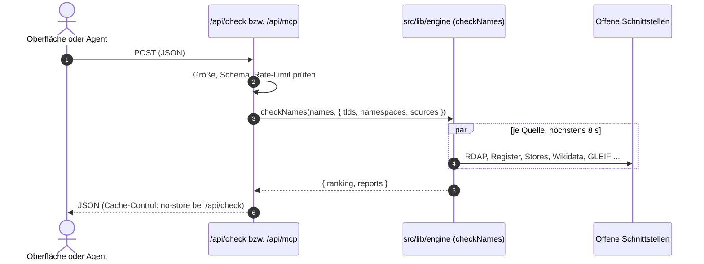

# `src/app/api/`: HTTP-Routen

Drei Route Handler, alle nur `POST`. Keine LLM-Aufrufe, keine Speicherung von Anfragen.
Jede Route geht durch `guardRequest` aus `src/lib/rate-limit.ts` (Standard 60 Einheiten pro
Minute und IP). Bei Überschreitung kommt `429` mit `Retry-After`.

| Route | Zweck | Kosten fürs Rate-Limit |
|---|---|---|
| `POST /api/check` | Prüfung eines Namens oder einer Shortlist für die Oberfläche | Anzahl der Namen |
| `POST /api/mcp` | MCP über Streamable HTTP, derselbe Server wie bei stdio | Anzahl der Namen bei `markenfrei_check_names`, sonst 1 |
| `POST /api/opendata-words` | Wortfeld und regelbasierte Vorschläge für „Keine Idee?“ | 1 |



---

## `POST /api/check` (`check/route.ts`)

Eingabe (mit zod geprüft):

```json
{
  "names": ["wachwerk", "fokusnova"],
  "tlds": ["de", "com"],
  "namespaces": ["domains", "packages"],
  "sources": ["npm", "nuget"]
}
```

- `names`: 1 bis 10 Texte, Pflicht.
- `tlds`, `namespaces`, `sources`: optional. Ohne Angabe gelten die Standardwerte der Engine
  (Endungen `de`, `com`, `dev`, `app`, `io`; Namensräume `domains`, `packages`, `stores`,
  `known_names`).
- `sources` ersetzt die Standardauswahl außerhalb von Domains. Wer Zusatzquellen will, schickt
  die gewünschten Standardquellen mit (so macht es die Oberfläche).

Ausgabe: `{ "ranking": ShortlistEntry[], "reports": NameReport[] }` aus `checkNames`.
`NameReport` hat `schemaVersion: 2`, `verdict`, `results` (ein `SourceResult` je Quelle),
`incomplete`, `trademark` und `manualLinks`. Die Antwort trägt `Cache-Control: no-store`.

Fehler, jeweils `{ "error": "<deutsche Meldung>" }`:

| Status | Fall |
|---|---|
| 400 | kaputtes JSON, falsche Typen, keine oder mehr als 10 Namen, unbekannte Endung, Quelle oder Namensraum, ungültiger Name |
| 413 | Body größer als 16 KB (auch ohne `Content-Length`, der Body wird beim Lesen gezählt) |
| 429 | Rate-Limit erreicht |
| 500 | unerwarteter Fehler, allgemeine Meldung |

---

## `POST /api/mcp` (`mcp/route.ts`)

Zustandsloser MCP-Endpunkt (`WebStandardStreamableHTTPServerTransport`, Antworten als JSON).
Der Server kommt aus `src/mcp/server.ts`, damit stdio und HTTP dieselben vier Tools haben.

Prüfungen in dieser Reihenfolge:

1. **Origin:** fehlt der Header, ist der Aufruf erlaubt. Sonst nur der eigene Host (`Host`,
   `x-forwarded-host`), `localhost`, `127.0.0.1` und die Einträge aus
   `MARKENFREI_ALLOWED_ORIGINS`. Andernfalls `403` mit JSON-RPC-Fehler `-32000`.
2. **Größe:** Body höchstens 64 KB, sonst `413` mit `-32600`.
3. **Rate-Limit:** Kosten wie in der Tabelle oben.
4. **Batch:** ein JSON-Array wird mit `400` und `-32600` abgelehnt.
5. Kaputtes JSON beantwortet der Transport mit `-32700`.

`GET` liefert `405`.

---

## `POST /api/opendata-words` (`opendata-words/route.ts`)

Eingabe: `{ "keywords": ["schicht", "plan"] }` (Liste oder kommagetrennter Text), optional
`description`, `brandSeed`, `maxLen` (Standard 11) und `avoid`. Ausgabe ist das
`OpenDataWordField` aus `src/lib/opendata.ts`, darin `synthesizedCandidates`. Die Vorschläge
sind regelbasiert und ungeprüft; die Oberfläche prüft sie erst auf Klick über `/api/check`.
