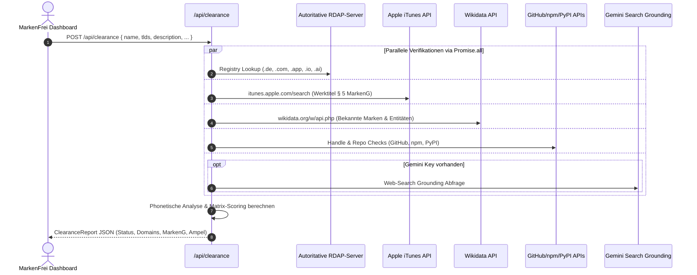

# `src/app/api/` · Backend Route Handlers & Gateway-Schicht

Dieses Verzeichnis stellt die serverseitigen HTTP-Endpunkte (Next.js App Router Route Handlers) bereit. Es orchestriert parallele Hintergrund-Recherchen über autoritative RDAP-Registries, Apple iTunes, Wikidata, GitHub, Paketmanager sowie LLM-APIs.

---

## 1. Endpunkt-Übersicht



---

## 2. Endpunkt-Spezifikationen

### A. `POST /api/clearance` (`clearance/route.ts`)
Führt eine vollständige Multi-Vektor-Prüfung für einen konkreten Namen durch.

- **Request Body:**
  ```typescript
  {
    name: string;             // z. B. "wachwerk"
    tagline?: string;
    category?: string;
    description?: string;     // Projektbeschreibung für Nizza-Klassen
    keywords?: string[];      // Kernbegriffe
    tlds?: string[];          // Default: ["de", "com", "app", "ai", "io"]
    provider?: string;
    apiKey?: string;
  }
  ```

- **Parallele Prüf-Module:**
  1. **Domain-Verfügbarkeit (`checkSingleDomain`):**
     - Fragt autoritative RDAP-Server ab:
       - `.de`: `https://rdap.denic.de/domain/{domain}`
       - `.com` / `.net`: `https://rdap.verisign.com/com/v1/domain/{domain}`
       - `.app` / `.dev`: `https://pubapi.registry.google/rdap/domain/{domain}`
       - `.io` / `.ai`: `https://rdap.identitydigital.services/rdap/domain/{domain}`
     - Status: `200..299` = `taken`, `404` = `available`, sonst `unknown` (mit Retry bei Rate-Limits).
     - Erzeugt Direktlinks zu INWX, IONOS, Namecheap und Porkbun.
  2. **Apple App Store Werktitelschutz (`checkAppleAppStore`):**
     - Fragt die deutsche iTunes-Schnittstelle ab (`https://itunes.apple.com/search?term={name}&country=de&entity=software&limit=5`).
     - Extrahiert den App-Haupttitel vor Doppelpunkt oder Bindestrich.
     - Vergleicht exakt und über Kölner Phonetik.
     - Status: `"clear"` | `"similar"` | `"collision"` (§ 5 Abs. 3 MarkenG).
  3. **Wissensdatenbanken & Enzyklopädie:**
     - **Wikidata API:** Fragt `https://www.wikidata.org/w/api.php` nach bekannten Marken und Unternehmen ab.
     - **Wikipedia REST API:** Fragt `https://de.wikipedia.org/api/rest_v1/page/summary/{name}` nach bestehenden Artikeln ab.
     - **DuckDuckGo Instant Answer:** Prüft `https://api.duckduckgo.com/?q={name}&format=json` auf Zero-Click-Entitäten.
  4. **Entwickler- & Paket-Namensräume (`checkDevAndSocial`):**
     - Prüft `api.github.com/users/{name}` und sucht Repositories mit hoher Star-Anzahl.
     - Prüft `registry.npmjs.org/{name}`, `pypi.org/pypi/{name}/json`, `crates.io/api/v1/crates/{name}`, `formulae.brew.sh/api/formula/{name}.json` und `proxy.golang.org/{name}/@v/list`.
  5. **Mobile App Bundle-IDs & Werktitelschutz (`auditCandidateBundleIds`):**
     - Prüft kanonische Identifiers (`de.{name}.app`, `com.{name}.app`, `io.{name}.app`) live gegen Apple App Store und Google Play Store.
  6. **Domain-Preisvergleich (`compareDomainPrices`):**
     - Liefert für jede TLD den günstigsten Dauerpreis (Netcup, Hetzner, Cloudflare, Porkbun) und warnt vor Lockangeboten.
  7. **KI-Marken-Grounding (`checkGeminiGroundedTrademark`):**
     - Optional bei Google Gemini: Nutzt `google_search` Tool-Grounding zur Erkennung real existierender, noch nicht im DPMA eingetragener Brands.

- **Response:** `ClearanceReport`

---

### B. `POST /api/rea-inspect` (`rea-inspect/route.ts`)
Inspiziert Shipped-Binaries, lokale macOS/iOS `.app`-Bundles, `Info.plist`-Dateien oder mobile Bundle-IDs unter Einbindung der REA-Architektur.

- **Request Body:**
  ```typescript
  {
    appPath?: string;     // z. B. "/Applications/MyApp.app" oder Pfad zur Info.plist
    bundleId?: string;    // z. B. "de.firma.wachwerk" oder "com.example.app"
  }
  ```
- **Funktionsweise:**
  1. Extrahiert App-Identität (`bundleId`, `displayName`, `version`, `minOsVersion`) über natives `/usr/bin/plutil` oder XML-Parsing.
  2. Prüft die extrahierte Bundle-ID parallel auf Apple App Store und Google Play Store.
  3. Führt sofort eine markenrechtliche Schutzfähigkeits- und Kollisionsprüfung für den App-Titel durch (§ 5 & § 9 MarkenG).
- **Response:**
  ```json
  {
    "identity": { "bundleId": "...", "displayName": "...", "sourceType": "local-plist" },
    "stores": { "appleAppStore": { "status": "..." }, "googlePlay": { "status": "..." } },
    "trademark": { "cleanName": "...", "niceClasses": [...], "officialFees": {...} },
    "verdict": "frei" | "kollision" | "markenkonflikt"
  }
  ```

---

### C. `POST /api/generate` (`generate/route.ts`)
Generiert markenrechtlich starke Namenskandidaten über Open-Data oder Bring-Your-Own-Key LLMs.

- **Request Body:**
  ```typescript
  {
    provider?: "opendata" | "google" | "anthropic" | "openai" | ...;
    model?: string;
    apiKey?: string;
    baseUrl?: string;
    brandSeed?: string;
    description?: string;
    keywords?: string | string[];
    tone?: string;
    styles?: string[];        // "brandable", "portmanteau", "neolatin", "compound", "short"
    avoid?: string;           // Zu vermeidende Begriffe
    maxLen?: number;          // Default: 11
    count?: number;           // Default: 12
    exclude?: string[];       // Bereits vorhandene Namen ausschließen
  }
  ```

---

### C. `POST /api/opendata-words` (`opendata-words/route.ts`)
Leichtgewichtiger Endpoint für das interaktive Open-Data Wortlabor in der Benutzeroberfläche.
- Nimmt `keywords`, `description`, `brandSeed`, `maxLen` und `avoid` entgegen.
- Gibt das strukturierte `OpenDataWordField` mit Live-Synonymen und Kunstwörtern zurück.

---

### D. `GET /api/ollama-models` (`ollama-models/route.ts`)
Prüft die Verfügbarkeit eines lokalen Ollama-Servers auf dem Rechner des Nutzers (`http://localhost:11434/api/tags`, 1500ms Timeout).
- Rückgabe: `{ running: boolean, models: string[] }`.
