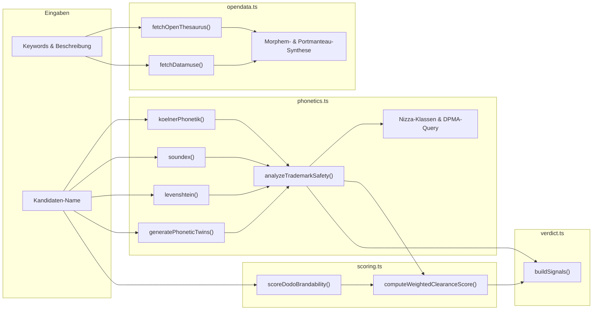

# `src/lib/` · Domain-, Linguistik- & Markenrechts-Engine

Dieses Verzeichnis bildet das algorithmische Herzstück von MarkenFrei. Es implementiert zustandslose linguistische Wortfeld-Analysen, phonetische Sound-Alike-Algorithmen nach deutschem Markenrecht (§ 8 und § 9 MarkenG), deterministisches Brandability-Scoring sowie die Multi-Provider-LLM-Registrierung.

---

## 1. Modul-Übersicht & Datenfluss

---

## 2. Modul-Spezifikationen & Schnittstellen

### A. `opendata.ts` · Lexikalische Open-Data-Engine
Ermöglicht Namensgenerierung und semantische Assoziationen **ohne API-Key** durch Abfrage öffentlich zugänglicher Sprachkorpora.

- **`discoverOpenDataWords(params): Promise<OpenDataWordField>`**
  - **OpenThesaurus.de API:** Fragt synset-basierte Synonyme und Assoziationen über `https://www.openthesaurus.de/synonyme/search?q={term}&format=application/json&similar=true` ab (`timeout: 3500ms`).
  - **Datamuse / WordNet API:** Ruft semantisch verwandte Begriffe (`ml={query}`) und phonetisch/assoziative Trigger (`rel_trg={trigger}`) ab (`timeout: 3500ms`).
  - **Morphem- & Portmanteau-Synthesizer:**
    - Extrahiert 3–5-stellige Konsonant-Stämme aus den Ergebnissen.
    - Kombiniert Stämme mit 16 geschützten Brand-Suffixen (`-ora`, `-vio`, `-vela`, `-nova`, `-luma`, `-kura`, `-takt`, `-flux`, etc.).
    - Erzeugt Portmanteau-Kreuzungen mit Vokal-Brücken ("o").
    - Verknüpft Neo-Latein-Präfixe (`velo-`, `krono-`, `lumi-`, `prismo-`, etc.).
    - Filtert unartikulierte Konsonantenketten (`/[^aeiouy]{4,}/`) und Namen außerhalb von 4 bis `maxLen` Zeichen.

---

### B. `phonetics.ts` · Markenrecht & Phonetik
Implementiert die juristische Vorprüfung nach deutschem Markenrecht (§ 8, § 9 MarkenG).

- **`koelnerPhonetik(input: string): string`:**
  - Offizieller Algorithmus nach Hans Joachim Postel (1969).
  - Wandelt deutsche Umlaute und Sonderzeichen um (`ä->a`, `ö->o`, `ü->u`, `ß->ss`, `ph->f`).
  - Bildet Buchstaben auf Ziffern 0–8 basierend auf Kontext ab (z. B. Initiales `c` vor `a,h,k,l,o,q,r,u,x` = 4, sonst 8; `d,t` vor `c,s,z` = 8, sonst 2; `x` = 48 oder 8).
  - Fasst benachbarte Duplikate zusammen und entfernt interne Nullen (`0`).
- **`soundex(input: string): string`:**
  - Internationaler 4-Zeichen Sound-Code für englischsprachigen Klangvergleich.
- **`levenshtein(a: string, b: string): number`:**
  - Exakte Matrix-Distanz zur Identifizierung von Tippfehler-Verwechslungen.
- **`generatePhoneticTwins(word: string): string[]`:**
  - Generiert systematische Schreibvarianten, nach denen Markenprüfer suchen: `k <-> c`, `v <-> f`, `ph -> f`, `z <-> s`, `ai <-> ei`, `y <-> i`, `x <-> ks`, `qu -> kw`.
- **`analyzeTrademarkSafety(rawName, description, keywords): TrademarkAnalysis`:**
  - **Kollisionswächter:** Prüft gegen `PROTECTED_TECH_BRANDS` (80+ Tech-/SaaS-Marken wie Apple, Google, Klarna, Linear, Stripe, Notion). Erkennt exakte Treffer, Substrings, identische Kölner-Phonetik-Codes und `Levenshtein <= 1`.
  - **§ 8 Abs. 2 MarkenG (Freihaltebedürfnis / Unterscheidungskraft):** Gleicht mit 38 Gattungswurzeln ab (`app`, `tool`, `planer`, `rechner`, `direct`, etc.). Klassifiziert in:
    - `Fantasiename (Stark)`: Hohe originäre Kennzeichnungskraft.
    - `Kompositum / Anlehnung (Mittel)`: Sprechender Begriff mit kennzeichnendem Teil.
    - `Beschreibend (Schwach - § 8 MarkenG Risiko)`: Zurückweisungsrisiko beim DPMA.
  - **Nizza-Klassen (Nice Classification):**
    - Pflichtklassen: **Klasse 9** (Software & Apps) und **Klasse 42** (SaaS & Cloud-Plattformen).
    - Kontextbezogen: **Klasse 35** (E-Commerce/Business), **Klasse 38** (Messaging/Chat), **Klasse 41** (Bildung/Media), **Klasse 44** (Gesundheit/Medizin).
  - **DPMA-Expertensuchstring:** Generiert fertige Syntax, z. B.:
    `("wachwerk*" OR "vachverk*") AND (IC=09 OR IC=42)`
  - **Register-Links:** Tiefenverlinkung für DPMAregister, EUIPO TMview, WIPO Brand DB, USPTO und OffeneRegister.de.

---

### C. `scoring.ts` · Brandability & Clearance Matrix
Kombiniert deterministische Namens-Heuristiken mit juristischen Risiko-Scores.

- **`scoreDodoBrandability(domain: string): DodoDomainScore`:**
  - 6-Faktor-Zerlegung (max. 100 Punkte):
    - **Länge (max 25):** 4–10 Zeichen (25), <4 Zeichen (22), 11–12 Zeichen (20), 13–15 Zeichen (14), >15 Zeichen (8).
    - **Aussprache (max 25):** Abzüge für fehlende Vokale (-15), 4+ Konsonanten (-10), 3 Konsonanten (-4).
    - **Bindestriche (max 15):** 0 Bindestriche (15), 1 Bindestrich (4), >1 (0).
    - **Ziffern (max 15):** Keine Ziffern (15), mit Ziffern (6).
    - **TLD-Tier (max 15):** Tier 1 (.de, .com = 15), Tier 2 (.app, .ai, .io, .dev = 13), sonstige (8).
    - **Typo-Risiko (max 5):** Abzug bei Homoglyphen (`rn`, `vv`, `cl` -> -2) und 3 gleichen Zeichen (-2).
- **`computeWeightedClearanceScore(params): MatrixResult`:**
  - 10 gewichtete Kriterien (Gesamtgewicht 90):
    - `tm` (Gewicht 12): Markenrechts-Kollisionsfreiheit (§ 8 & § 9 MarkenG).
    - `domain` (Gewicht 10): RDAP/DNS Verfügbarkeitsquote.
    - `brandable` (Gewicht 10): Ästhetischer Markencharakter & Silbenfluss.
    - `appStore` (Gewicht 9): Apple App Store Werktitelschutz (§ 5 Abs. 3 MarkenG).
    - `short` (Gewicht 9): Längen-Optimum (4–8 Zeichen).
    - `spell` (Gewicht 9): Schreibbarkeit ohne Fehlerfallen.
    - `social` (Gewicht 8): Verfügbarkeit auf GitHub, npm, PyPI.
    - `future` (Gewicht 8): Zukunftssicherheit & Skalierbarkeit.
    - `pron` (Gewicht 8): Aussprachefluss.
    - `pro` (Gewicht 7): Professionelle Gesamtwirkung.
  - **Harte juristische Deckelung:** Bei schwerwiegender Markenkollision (`tm <= 3`) wird der Gesamtscore automatisch auf maximal **42** limitiert.
  - **Ampelurteil:**
    - 🟢 **Grün:** Score >= 80, `tm >= 7` und `appStore >= 6`.
    - 🔴 **Rot:** Score < 58 oder `tm <= 4` oder `appStore <= 3`.
    - 🟡 **Gelb:** Prüfenswert (manuelle Begutachtung empfohlen).

---

### D. `verdict.ts` · Verdichtung & Ampelsignale
Wandelt die Rohdaten der Prüf-Pipeline in verständliche, hierarchisch sortierte Handlungshinweise für den Anwender um.

---

### E. `doh.ts` · DNS-over-HTTPS Dual-Layer Fallback
Dient als zuverlässige Gegenprüfung und Ausfallabsicherung für RDAP.
- **`dohLookup(domain: string): Promise<DohLookupResult>`**
  - Fragt Google DoH (`https://dns.google/resolve?name={domain}&type=NS`) und Cloudflare DoH (`https://cloudflare-dns.com/dns-query`) ab.
  - Erkennt `Status === 0` mit aktiven Nameserver-Einträgen (`status: "taken"`).
  - Erkennt `Status === 3` (`NXDOMAIN`, `status: "likely-available"`).
  - Verhindert, dass RDAP-Rate-Limits (HTTP 429) zu falschen Annahmen führen.

---

### F. `rea.ts` · Reverse Engineering & App Ecosystem Bridge
Brücke zu Mobile App Stores und Shipped Binary Identifiers (§ 5 Abs. 3 MarkenG).
- **`checkAppleBundleId(bundleId)`**: Live-Abfrage des Apple iTunes Lookup API für iOS/macOS Bundle Identifiers (`country=de`).
- **`checkGooglePlayPackage(packageId)`**: Live-Abfrage des Google Play Store Package Namensraums (`status 200 = taken`, `404 = available`).
- **`auditCandidateBundleIds(cleanName)`**: Generiert und prüft kanonische Identifiers (`de.{name}.app`, `com.{name}.app`, `io.{name}.app`) parallel auf beiden Stores.
- **`inspectLocalAppBundle(targetPath)`**: Liest macOS/iOS `.app` Bundles und `Info.plist` Dateien via nativem macOS `/usr/bin/plutil` oder XML-Fallback aus und extrahiert `CFBundleIdentifier`, `CFBundleDisplayName`, `version` und Mindest-OS.

---

### G. `domain-pricing.ts` · Registrar-Preisvergleich & Hosting
Transparenter Preisvergleich führender Registrare ohne Lockvogel-Fallen.
- **`compareDomainPrices(domain: string): TldPriceComparison | null`**
  - Ermittelt für `.de`, `.com`, `.app`, `.ai`, `.io`, `.dev` die Preise bei Netcup, Hetzner, Cloudflare, Porkbun, INWX, IONOS und Namecheap.
  - Sortiert nach tatsächlichem **Verlängerungspreis (Renewal)**, damit Gründer nicht in 1-Euro-Lockangebote tappen.
  - Hebt **At-Cost Großhandelspreise** (z. B. Cloudflare Registrar mit 0 $ Markup) und **Lockvogel-Fallen** (Warnbadge) hervor.
  - Generiert vorbereitete Direktlinks mit vorausgefülltem Domainnamen.

---

### H. `open-apis.ts` · Zentrales Schnittstellen-Inventar
Erfasst alle 25 öffentlich genutzten Open APIs mit Provider, Endpoint, Protokoll (RDAP, DoH, REST) und Dokumentationslink.

---

### I. `providers.ts` · Multi-Provider Registry
Definiert 11 unterstützte Provider-Profile:
1. `opendata`: Zero-Key, 100% lokal & kostenlos.
2. `google`: Gemini 2.5 Flash / Flash Lite / Pro mit Web-Search Grounding.
3. `deepseek`: DeepSeek Chat V3 & R1 Reasoner.
4. `groq`: Llama 3.3 70B Versatile, Llama 3.1 8B Instant.
5. `openrouter`: Router für Multi-Provider-Zugriff.
6. `openai`: GPT-4o, GPT-4o Mini, GPT-4.1 Mini.
7. `anthropic`: Claude 3.5 Haiku, Claude 3.7 Sonnet.
8. `mistral`: Mistral Small / Large (EU-Hosting).
9. `xai`: Grok 2.
10. `ollama`: Lokaler HTTP-Endpunkt (`localhost:11434/v1`) für Llama 3.2, Qwen 2.5, DeepSeek-R1.
11. `custom`: Eigener OpenAI-kompatibler Server (LM Studio, vLLM).
