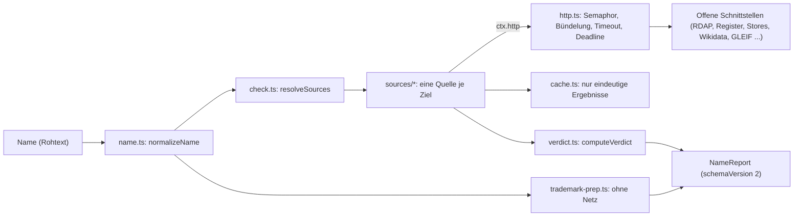

# `src/lib/`: Engine und Hilfsmodule

Hier liegt die Prüflogik von Markenfrei. Oberfläche, `/api/check` und der MCP-Server rufen
dieselben Funktionen auf; es gibt keine zweite Implementierung. Kein LLM, keine
Speicherung von Anfragen außer dem kurzen Cache im Arbeitsspeicher.

Verbindlich ist [docs/v2-spec.md](../../docs/v2-spec.md).

---

## Datenfluss einer Prüfung

---

## `engine/`

| Datei | Inhalt |
|---|---|
| `check.ts` | `checkName(input, opts)` und `checkNames(inputs, opts)` liefern `NameReport` bzw. `{ ranking, reports }`. `resolveSources` bestimmt die Quellen aus `namespaces`, `tlds` und `sources`. Grenzwerte: `MAX_NAMES` (10), `MAX_TLDS` (8), Deadline 8 s. Ungültige Eingaben werfen `CheckInputError` mit deutscher Meldung. `STATIC_SOURCES` listet alle Quellen außer Domains. |
| `types.ts` | Vertrag: `Status` (`taken`, `not_found`, `similar`, `invalid`, `unknown`), `Namespace`, `Source`, `SourceResult` (mit `weak` für schwache Signale), `HttpClient`. |
| `verdict.ts` | `computeVerdict`: Rot bei `taken` (nicht schwach), Grün nur wenn alle Quellen `not_found` melden, sonst Gelb. `invalid` (Name dort nicht zulässig) ergibt Gelb, nicht Rot. `rankReports` sortiert eine Shortlist. `VERDICT_LABEL`, `STATUS_LABEL`. |
| `http.ts` | `createHttpClient`: höchstens 4 gleichzeitige Anfragen pro Host, gleiche gleichzeitige Anfragen werden gebündelt, 5 s pro Anfrage, gemeinsame Deadline, Antwortkörper höchstens `maxBytes` (Standard 512 KB). `buildUserAgent` erzeugt `Markenfrei/2.0 (+https://markenfrei.app; <Kontakt>)`. |
| `trademark-prep.ts` | `trademarkPrep(name, opts)`: Registerlinks (Prüfdatum in `TRADEMARK_LINKS_CHECKED`), DPMA-Expertensuchstring, Schreibvarianten, Klassenvorschlag, Checkliste. Kein Netz. Die Belege zu jedem Link stehen im Kopfkommentar. |
| `report-schema.ts` | zod-Schemas für `NameReport`, `SourceResult`, `TrademarkPrep` und `ShortlistEntry`, genutzt als MCP-`outputSchema`. Ein Typabgleich beim Übersetzen hält sie mit den Engine-Typen gleich. |

### `engine/sources/`

| Datei | Quellen |
|---|---|
| `domains.ts` | `domainSources(tlds)`: eine Quelle je Endung (`rdap:<tld>`). RDAP-Server aus dem IANA-Bootstrap oder festen Einträgen (`de`, `io`, `ch`, `li`); `at` und `eu` nur über DNS. DoH bestätigt nur „vergeben“. `DOMAIN_TLDS` (33 Endungen), `DEFAULT_DOMAIN_TLDS`, `DOH_ONLY_TLDS`. |
| `packages.ts` | npm, PyPI, GitHub, crates.io, Homebrew (Standard); NuGet, RubyGems, Maven Central, Packagist, pub.dev, JSR, Hex.pm, CRAN, Open VSX, Hugging Face, Hackage, Terraform Registry, DEV (auf Wunsch). Je Register eine Syntaxprüfung (`invalid`). GitHub sperrt sich nach einem Rate-Limit bis zum Reset selbst. |
| `registries.ts` | Weitere offene Datenquellen für Paketnamen, alle auf Wunsch (Namensraum `packages`): AUR (aurweb-RPC; `type: "error"` ergibt `unknown`), Repology (Projektname; eigener User-Agent mit Quellcode-Link, Antworten über 64 KB gelten als vergeben, ohne sie zu laden) und über den Index von ecosyste.ms Docker Hub (offizielle Images), conda-forge, Clojars (Hinweis „nicht live aus dem Register“). Register mit schreibweisenabhängigen Namen (CocoaPods, CPAN, Julia) fehlen bewusst. Nutzt die Hilfen aus `packages.ts`. Budgets für `repology.org`, `packages.ecosyste.ms` und `aur.archlinux.org` in `http.ts`. |
| `stores-social.ts` | App Store, Google Play (Standard); F-Droid, Firefox Add-ons, Bluesky, Mastodon, Hacker News (auf Wunsch). `manualSocialLinks` liefert Links für Instagram, TikTok, X, YouTube und den Chrome Web Store. |
| `known-names.ts` | Marken-Heuristik `known_brands` (ohne Netz, Liste aus `phonetics.ts`), Wikidata (SPARQL), GLEIF (Standard); Wikipedia und Show HN als schwache Signale (auf Wunsch). |

Jede Quelle liefert genau ein `SourceResult`. Was nicht eindeutig beantwortet ist, wird
`unknown`, nie `not_found`.

---

## Hilfsmodule

| Datei | Inhalt |
|---|---|
| `name.ts` | `normalizeName`: Kleinbuchstaben, Umlaute ausgeschrieben (`Müller` → `mueller`), eine bekannte Endung aus `DOMAIN_TLDS` wird abgetrennt, sonst klare Fehlermeldung. `foldToAscii` für Vergleiche. |
| `phonetics.ts` | Kölner Phonetik, Soundex, Levenshtein, `generatePhoneticTwins` (Schreibvarianten), `PROTECTED_TECH_BRANDS` und `analyzeTrademarkSafety`. Die Engine nutzt daraus die Marken-Heuristik, die Varianten und die Klassenregeln. |
| `insights.ts` | `analyzeName` („Name im Detail“: Länge, geschätzte Silben, Ziffern, Bindestriche, Verwechslungspaare, Tippfehler, Ähnlichkeit zu bekannten Marken über `matchKnownBrands`; kein Punktwert), `generateVariants` (Präfixe, Suffixe, Bindestrich, Plural) und `buildShortlist`. Alles ohne Netz, rein und deterministisch. |
| `export.ts` | `toCsv` (RFC 4180, CRLF, ohne BOM, Formelanfänge `= + - @ Tab CR` mit `'` entschärft, eine Zeile je Name und Quelle), `toMarkdown` (Abschnitt je Name, Quellentabelle, Schlusszeile „Vorprüfung, keine Rechtsberatung. Marke nicht geprüft.“) und `exportFileName`. Rein, für die Export-Schaltflächen der Oberfläche. |
| `matrix.ts` | `matrixColumns` und `matrixCell`: Text und Schwere je Name und Namensraum für die Vergleichsmatrix („nichts gefunden“, „vergeben: .de, .com“, „ohne Antwort“; nie „frei“). Rein. |
| `cache.ts` | `createTtlCache` und `cachedLookup`: Cache im Arbeitsspeicher, nur für eindeutige Ergebnisse. Standard 10 Minuten, `MARKENFREI_CACHE_TTL_SEC` ändert das, `0` schaltet ihn aus. `clearAllCaches` für Tests. |
| `rate-limit.ts` | `guardRequest(req, cost)`: festes Zeitfenster pro IP (aus `x-forwarded-for`), Standard 60 Einheiten pro Minute (`MARKENFREI_RATE_LIMIT`). Gilt pro Serverprozess. |
| `opendata.ts` | `discoverOpenDataWords`: Wortfeld aus OpenThesaurus und Datamuse (je 3,5 s Timeout) und regelbasierte Kandidaten aus festen Wortbausteinen. Für „Keine Idee?“ und `markenfrei_suggest_names`. Die Kandidaten sind ungeprüft. |

---

## Tests

Die Tests liegen in `tests/` (`npm test`), meist eine Testdatei je Modul, z. B.
`sources-packages.test.ts` oder `trademark-prep.test.ts`. Quellen werden mit einem
gestubbten `HttpClient` bzw. `fetch` geprüft, ohne Netz. `opendata.ts` hat noch keine Tests.
