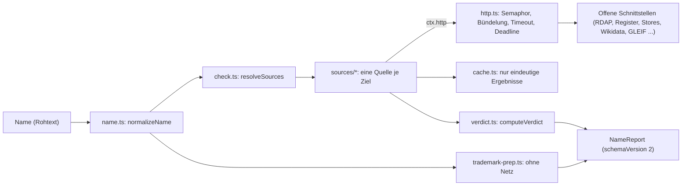

# `src/lib/`: Engine und Hilfsmodule

Hier liegt die Prüflogik von Markenfrei. Oberfläche, `/api/check` und der MCP-Server rufen
dieselben Funktionen auf; es gibt keine zweite Implementierung. Kein LLM, keine
Speicherung von Anfragen außer dem kurzen Cache im Arbeitsspeicher.

Verbindlich ist [docs/v2-spec.md](../../docs/v2-spec.md).

---

## Datenfluss einer Prüfung

---

## `engine/`

| Datei | Inhalt |
|---|---|
| `check.ts` | `checkName(input, opts)` und `checkNames(inputs, opts)` liefern `NameReport` bzw. `{ ranking, reports }`. `resolveSources` bestimmt die Quellen aus `namespaces`, `tlds` und `sources`. Grenzwerte: `MAX_NAMES` (10), `MAX_TLDS` (8), Deadline 8 s. Ungültige Eingaben werfen `CheckInputError` mit deutscher Meldung. `STATIC_SOURCES` listet alle Quellen außer Domains. |
| `types.ts` | Vertrag: `Status` (`taken`, `not_found`, `similar`, `invalid`, `unknown`), `Namespace`, `Source`, `SourceResult` (mit `weak` für schwache Signale), `HttpClient`. |
| `verdict.ts` | `computeVerdict`: Rot bei `taken` (nicht schwach), Grün nur wenn alle Quellen `not_found` melden, sonst Gelb. `invalid` (Name dort nicht zulässig) ergibt Gelb, nicht Rot. `rankReports` sortiert eine Shortlist. `VERDICT_LABEL`, `STATUS_LABEL`. |
| `http.ts` | `createHttpClient`: höchstens 4 gleichzeitige Anfragen pro Host, gleiche gleichzeitige Anfragen werden gebündelt, 5 s pro Anfrage, gemeinsame Deadline, Antwortkörper höchstens `maxBytes` (Standard 512 KB). Abfragebudget je Zieldienst (`HOST_BUDGETS`, `takeBudget`, gleitendes Fenster, pro Prozess): ist es erschöpft, wartet die Anfrage kurz oder endet mit `error: "budget"`, bei einem nächsten freien Platz in mehr als 60 s (`LONG_BUDGET_WAIT_MS`) mit `"budget_long"` (Ergebnis `unknown`, nicht wiederholbar). `buildUserAgent` erzeugt `Markenfrei/2.0 (+https://markenfrei.app; <Kontakt>)`. |
| `trademark-prep.ts` | `trademarkPrep(name, opts)`: Registerlinks (Prüfdatum in `TRADEMARK_LINKS_CHECKED`), DPMA-Expertensuchstring, Schreibvarianten, Klassenvorschlag, Checkliste. `trademarkPrepForSelection(name, description, classes)` baut dieselbe Vorbereitung für die Eingaben im Markenblock der Oberfläche (läuft auch im Browser; `null` folgt dem Vorschlag, eine leere Liste ergibt einen Suchstring ohne Klasseneinschränkung). `NICE_CLASSES`: alle Nizza-Klassen 1 bis 45 mit Kurzüberschrift für die Klassenwahl. Kein Netz. Die Belege zu jedem Link stehen im Kopfkommentar. |
| `report-schema.ts` | zod-Schemas für `NameReport`, `SourceResult`, `TrademarkPrep` und `ShortlistEntry`, genutzt als MCP-`outputSchema`. Ein Typabgleich beim Übersetzen hält sie mit den Engine-Typen gleich. |
| `format.ts` | Textausgabe, Shortlist-Vorbereitung und Quellenauswahl für MCP, HTTP und Kommandozeile, ohne MCP-SDK: `formatReport`, `formatRanking`, `prepareShortlist`. `effectiveSources` ergänzt bei `social` ohne `sources` die Quellen Bluesky und Mastodon (`SOCIAL_AUTO_SOURCE_IDS`). `CHECK_PROFILES` baut die Profile aus `profiles.ts` und `STATIC_SOURCES`; `selectSources` bestimmt aus Profil und ausdrücklichen Angaben (`namespaces`, `tlds`, `sources`) die Auswahl für Prüfung und Kosten fürs Rate-Limit und wirft bei unbekanntem Profil `CheckInputError`. |
| `url.ts` | `safeHttpUrl`: lässt nur `http` und `https` ohne Zugangsdaten und höchstens 2048 Zeichen durch, damit Links aus Antworten Dritter keine `javascript:`- oder `data:`-Adressen einschleusen. |

### `engine/sources/`

| Datei | Quellen |
|---|---|
| `domains.ts` | `domainSources(tlds)`: eine Quelle je Endung (`rdap:<tld>`). RDAP-Server aus dem IANA-Bootstrap (24 h im Prozess), ersatzweise aus dem Schnappschuss `rdap-tlds.json`, oder festen Einträgen (`de`, `io`, `ch`, `li`); `at` und `eu` nur über DNS. DoH bestätigt nur „vergeben“. `FEATURED_TLDS` (33 einzeln geprüfte Endungen, die Chips der Oberfläche), `DOMAIN_TLDS` (kuratierte plus Schnappschuss), `DEFAULT_DOMAIN_TLDS`, `DOH_ONLY_TLDS`, `isDomainTld`. Nur bei den kuratierten Endungen ergibt RDAP-404 „nicht gefunden“, bei allen anderen „unbekannt“ mit Hinweis. Der Schnappschuss wird von Hand mit `scripts/update-rdap-tlds.ts` erneuert, nie im Build. |
| `packages.ts` | npm, PyPI, GitHub, crates.io, Homebrew (Standard); NuGet, RubyGems, Maven Central, Packagist, pub.dev, JSR, Hex.pm, CRAN, Open VSX, Hugging Face, Hackage, Terraform Registry, DEV (auf Wunsch). Je Register eine Syntaxprüfung (`invalid`). GitHub sperrt sich nach einem Rate-Limit bis zum Reset selbst. |
| `registries.ts` | Weitere offene Datenquellen für Paketnamen, alle auf Wunsch (Namensraum `packages`): AUR (aurweb-RPC; `type: "error"` ergibt `unknown`), Repology (Projektname; eigener User-Agent mit Quellcode-Link, Antworten über 64 KB gelten als vergeben, ohne sie zu laden) und über den Index von ecosyste.ms Docker Hub (offizielle Images), conda-forge, Clojars (Hinweis „nicht live aus dem Register“). Register mit schreibweisenabhängigen Namen (CocoaPods, CPAN, Julia) fehlen bewusst. Nutzt die Hilfen aus `packages.ts`. Budgets für `repology.org`, `packages.ecosyste.ms` und `aur.archlinux.org` in `http.ts`. |
| `stores-social.ts` | App Store, Google Play (Standard); F-Droid, Firefox Add-ons, Bluesky, Mastodon, Hacker News (auf Wunsch). `manualSocialLinks` liefert Links für Instagram, TikTok, X, YouTube und den Chrome Web Store. |
| `wikidata-brands.ts` | Quelle `wikidata_brands` (nur auf Wunsch, nur Server): Ähnlichkeitsvergleich gegen den Schnappschuss `wikidata-brands.json` (Format: `wikidata-brands-format.ts`, Vergleich: `src/lib/brand-similarity.ts`). Nie `taken`; fehlender oder kaputter Schnappschuss ergibt `unknown`. |
| `known-names.ts` | Marken-Heuristik `known_brands` (ohne Netz, Liste aus `phonetics.ts`), Wikidata (SPARQL), GLEIF (Standard); Wikipedia und Show HN als schwache Signale (auf Wunsch). |

Jede Quelle liefert genau ein `SourceResult`. Was nicht eindeutig beantwortet ist, wird
`unknown`, nie `not_found`.

---

## Hilfsmodule

| Datei | Inhalt |
|---|---|
| `name.ts` | `normalizeName`: Kleinbuchstaben, Umlaute ausgeschrieben (`Müller` → `mueller`), eine bekannte Endung aus `DOMAIN_TLDS` wird abgetrennt, sonst klare Fehlermeldung. `foldToAscii` für Vergleiche. |
| `phonetics.ts` | Kölner Phonetik, Soundex, Levenshtein, `generatePhoneticTwins` (Schreibvarianten), `PROTECTED_TECH_BRANDS` und `analyzeTrademarkSafety`. Die Engine nutzt daraus die Marken-Heuristik, die Varianten und die Klassenregeln. |
| `insights.ts` | `analyzeName` („Name im Detail“: Länge, geschätzte Silben, Ziffern, Bindestriche, Verwechslungspaare, Tippfehler, Ähnlichkeit zu bekannten Marken über `matchKnownBrands`; kein Punktwert), `generateVariants` (Präfixe, Suffixe, Bindestrich, Plural) und `buildShortlist`. Alles ohne Netz, rein und deterministisch. |
| `export.ts` | `toCsv` (RFC 4180, CRLF, ohne BOM, Formelanfänge `= + - @ Tab CR` mit `'` entschärft, eine Zeile je Name und Quelle), `toMarkdown` (Abschnitt je Name, Quellentabelle, Schlusszeile „Vorprüfung, keine Rechtsberatung. Marke nicht geprüft.“) und `exportFileName`. Rein, für die Export-Schaltflächen der Oberfläche. |
| `matrix.ts` | `matrixColumns` und `matrixCell`: Text und Schwere je Name und Namensraum für die Vergleichsmatrix („nichts gefunden“, „vergeben: .de, .com“, „ohne Antwort“; nie „frei“). Rein. |
| `cache.ts` | `createTtlCache` und `cachedLookup`: Cache im Arbeitsspeicher, nur für eindeutige Ergebnisse. Standard 10 Minuten, `MARKENFREI_CACHE_TTL_SEC` ändert das, `0` schaltet ihn aus. `clearAllCaches` für Tests. |
| `rate-limit.ts` | `guardRequest(req, cost)`: festes Zeitfenster pro IP (aus `x-forwarded-for`), Standard 60 Einheiten pro Minute (`MARKENFREI_RATE_LIMIT`). Gilt pro Serverprozess. |
| `opendata.ts` | `discoverOpenDataWords`: Wortfeld aus OpenThesaurus und Datamuse (je 3,5 s Timeout) und regelbasierte Kandidaten aus festen Wortbausteinen. Für „Keine Idee?“ und `markenfrei_suggest_names`. Die Kandidaten sind ungeprüft. |
| `brand-match.ts` | `matchKnownBrands` und `containsAtBoundary`: Abgleich eines Namens mit der Markenliste aus `phonetics.ts`, ohne Netz. Liegt hier statt in `engine/sources/known-names.ts`, damit Browser-Code nicht die Quellen samt Schnappschuss erreicht (`tests/client-bundle-boundary.test.ts`); `known-names.ts` re-exportiert beides. |
| `brand-similarity.ts` | `buildBrandIndex` und `compareWithBrands`: reiner Ähnlichkeitsvergleich eines Namens gegen eine übergebene Markenliste (gleich, klanggleich, schreibähnlich, enthalten). Keine Dateizugriffe, kein Netz. Grundlage der Quelle `wikidata_brands`. |
| `match-highlight.ts` | `highlightMatch`: markiert, welche Buchstaben einer ähnlichen Marke mit dem Namen übereinstimmen. Reine Funktion, nur Markierung, keine Wertung. |
| `ics.ts` | Erinnerung als iCalendar-Datei (RFC 5545): ein ganztägiger Termin 30 Tage nach dem lokalen Datum (`REMINDER_DAYS`). Rein, ohne Netz; entsteht nur im Browser, es wird nichts gesendet oder gespeichert. |
| `register.ts` | Registrierungs-Link des Betreibers für Domains (rein, ohne Netz): `registerConfigFromEnv` liest `MARKENFREI_REGISTER_URL` (https-Vorlage mit `{domain}`, optional `{name}`, `{tld}`) und `MARKENFREI_REGISTER_NAME`, `registerLink` setzt die Domain URL-kodiert ein. Der Domainname steht nur im Link, den der Nutzer selbst öffnet; ohne gültige Einstellung gibt es nirgends einen Link. `REGISTER_NOTICE` ist der feste Hinweis daran. |
| `profiles.ts` | Vorhaben (Profile) für Oberfläche, API, MCP und CLI: fertige Auswahlen von Namensräumen, Quellen und Endungen für typische Projekte (Web-App, Python-Paket, …). `buildProfiles` baut sie aus der Quellenliste; „Allgemein“ ist die Standardauswahl, jedes andere Vorhaben nimmt dazu die Standardquellen der bekannten Namen. Reine Daten, ohne React und ohne Quellcode der Engine. |
| `snapshot-link.ts` | „Stand kopieren“: ein fertiges Ergebnis (Namen, je Quelle Status und schwacher Treffer, Zeitpunkt) als Teil hinter `#stand=` im Link, JSON mit `deflate-raw` komprimiert und base64url-kodiert (`encodeShared`, `decodeShared`). Der Teil hinter „#“ geht nie an den Server; wer den Link öffnet, sieht das Ergebnis ohne neue Abfrage. Lesen prüft streng (Version, Größen, Status) und gibt sonst `null` zurück. Nutzt die Streams von Browser und Node. |
| `verdict-bar.ts` | `buildVerdictBar`: Aufbau des gegliederten Balkens über der Ergebnisliste, nach Anzahl der Quellen (vier feste Segmente, keine Prozentwerte). Rein, ohne React. |
| `probe-status.ts` | Datenformat der Live-Probe (`probe-status.json`): je Quelle nur Kennung und Status (`toProbeStatus`, `probeStatusSchema`), `isStale` für Stände über 14 Tage. |
| `probe-canaries.ts` | Kanariennamen der Live-Probe je Quelle (`CANARIES`) und die begründeten Ausnahmen (`PROBE_EXCLUSIONS`). `coverageProblems` prüft, dass jede Quelle aus `STATIC_SOURCES` genau einen Eintrag hat; Probe und `tests/probe-canaries.test.ts` nutzen es. |
| `sources-catalog.ts` | `buildSourcesCatalog` und `SourcesCatalogSchema`: maschinenlesbarer Quellenkatalog für `GET /api/sources` und die Seite `/quellen`. Reine Daten aus dem Code. |
| `openapi.ts` | `buildOpenApiDocument`: OpenAPI-3.1-Beschreibung der öffentlichen Routen für `GET /api/openapi.json`, aus den Konstanten und zod-Schemas der Engine erzeugt. |
| `llms-txt.ts` | `buildLlmsTxt`: Inhalt von `/llms.txt`, eine kurze Beschreibung für Sprachmodelle und Agenten. Zahlen und Listen kommen aus dem Code. |
| `opensearch.ts` | `buildOpenSearchXml`: OpenSearch-Beschreibung für „Als Suchmaschine hinzufügen“, ohne Vorschlags-URL. |
| `security-headers.ts` | `buildCsp` und `securityHeaders`: Security-Header für alle Antworten (CSP ohne Nonce, siehe `next.config.ts`). |
| `security-txt.ts` | `buildSecurityTxt` und `securityTxtFromEnv`: `security.txt` nach RFC 9116 mit Kontaktadresse des Betreibers und Ablaufdatum (180 Tage). |
| `site.ts` | Name, Titel, Beschreibung und öffentliche Adresse (`publicUrl`, aus `MARKENFREI_PUBLIC_URL`), dazu die Seiten der Sitemap. |
| `structured-data.ts` | `webApplicationJsonLd` und `faqPageJsonLd`: schema.org-Beschreibung als JSON-LD, statisch und ohne Nutzereingaben. |
| `guides.ts` | `GUIDES`: Pfad, Navigationstext und Kurzbeschreibung der Anleitungsseiten. |
| `legal.ts` | `operatorFromEnv`: Betreiberangaben für Impressum und Datenschutzerklärung aus der Umgebung; fehlende Pflichtangaben werden gemeldet, nichts wird erfunden. |
| `mail.ts` | Versand der Kontaktformular-Nachrichten per SMTP (nodemailer, `MARKENFREI_SMTP_URL`). Nichts wird gespeichert oder wiederholt; Fehler tragen keine Zugangsdaten oder Texte der Besucher. |
| `contact-limits.ts` | Grenzen des Kontaktformulars (Längen, frühester und spätester Zeitpunkt zum Absenden), gemeinsam für Oberfläche und `POST /api/contact`. |
| `contact-token.ts` | Vom Server mit HMAC-SHA-256 signierte Zeitmarke des Kontaktformulars (`checkContactToken`); hält nur einfache Bots ab. |
| `checker-setup.ts` | `buildCheckerConfig`: macht die Quellenliste zu reinen Daten für die Oberfläche des Prüfers, damit der Engine-Code nicht ins Client-Bundle gelangt. |
| `analytics.ts` | Reichweitenmessung ohne personenbezogene Daten, nur im Browser: sendet nur an den eigenen Server (`/_gc/count`), ohne Cookies und ohne Browser-Speicher, beachtet Do Not Track und Global Privacy Control. |
| `theme.ts` | Darstellung hell, dunkel oder System. Der Browser merkt sich die Wahl unter `markenfrei:theme` nur bei „Hell“ oder „Dunkel“; „System“ löscht den Eintrag. Nichts davon erreicht den Server. |
| `history.ts` | Verlauf „Zuletzt geprüft“, nur wenn eingeschaltet: höchstens 12 Einträge unter `markenfrei:history` im Browser, je Eintrag der Query-Teil des Links, der Zeitpunkt und, sobald die Prüfung fertig ist, je Name und Quelle der Status (Kurzcode). Ausschalten löscht den Eintrag; nichts davon erreicht den Server. Rein, ohne Browser-APIs. |
| `version.ts` | `APP_VERSION` aus `package.json`; gleich mit der MCP-Version (geprüft in `tests/docs-consistency.test.ts`). |

---

## Tests

Die Tests liegen in `tests/` (`npm test`), meist eine Testdatei je Modul, z. B.
`sources-packages.test.ts` oder `trademark-prep.test.ts`. Quellen werden mit einem
gestubbten `HttpClient` bzw. `fetch` geprüft, ohne Netz. `opendata.ts` hat Tests in `tests/engine-opendata.test.ts`.
